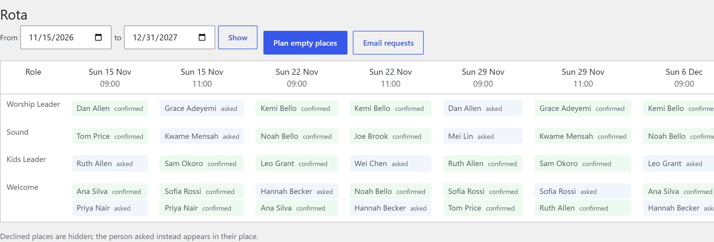
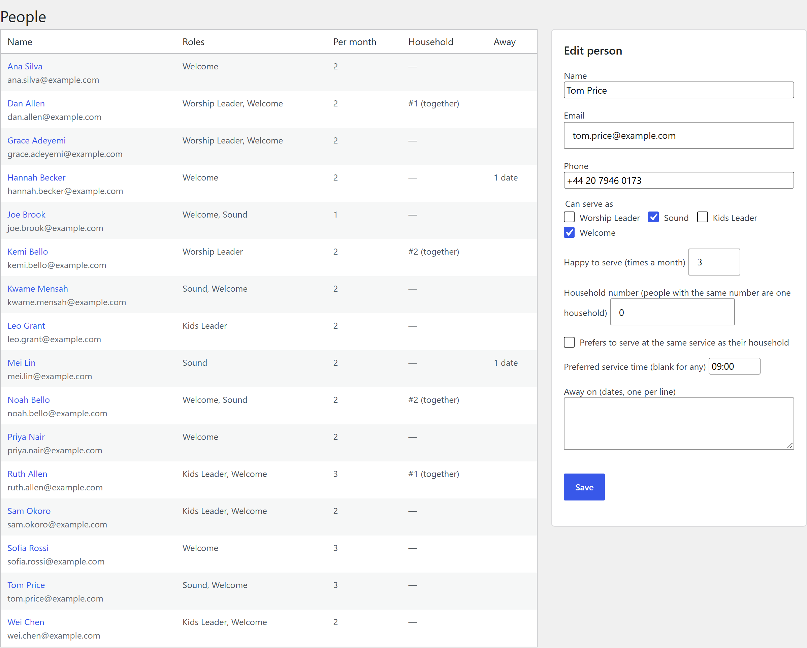
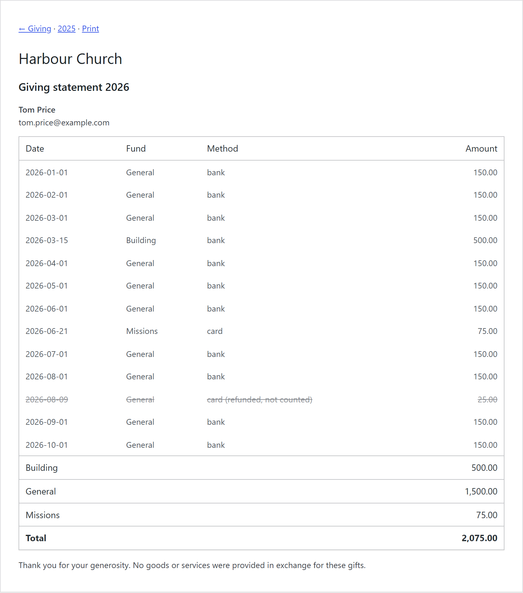

# Congregation: Church Management for WordPress

[](https://github.com/codeROCK-IZZY/wordpress-church-suite/actions/workflows/ci.yml)


A WordPress plugin for running a church's week-to-week life from its own website:

- **Volunteer rotas** that fill every place without overloading anyone. People answer "Can you serve?" from a link in
  their email, and anyone who declines is replaced automatically.
- **People and households.**
- **Giving records** with year-end statements.
- **Sermons** with an archive and a podcast feed that podcast apps accept.

The rota is where most of the work goes. In most churches, each team leader keeps their own spreadsheet. Nobody can
see that the same person is on sound *and* welcome at 11:00, or that someone who offered one Sunday a month is down
for three. The reliable few get asked every week until they burn out, while a quarter of the people who offered to
help are never asked at all.



## Results

`php eval/run.php --gate` simulates churches over a quarter (13 Sundays). Each volunteer can do one to three roles,
offers one to four Sundays a month, is away for a holiday or two, may prefer one service time, and may want to serve
alongside their household. Some roles have only one or two trained people. After the rota goes out, some people
decline and must be replaced. The scheduler's weights were set on 15 tuning churches. These are **40 held-out
churches** (3,030 volunteers, 12,896 places):

| Rota made by | Places filled | Filled after declines | Two roles at one service | Over a person's monthly limit | Volunteers never asked | Back-to-back Sundays | Households split |
|---|---:|---:|---:|---:|---:|---:|---:|
| Team spreadsheets (each leader rotates their own list) | 93.2%* | 90.0% | **1,141** | **2,337** | 3.1% | 25.3% | 24.1% |
| One coordinator, first person who can | 88.5% | 86.1% | 0 | 0 | 26.2% | 34.1% | 5.6% |
| **This plugin** | **90.9%** | **88.5%** | **0** | **0** | **0.1%** | **11.1%** | **1.1%** |

\* Team spreadsheets look fullest only because 1,141 of their places go to someone already serving elsewhere at that
service. Counting those as empty, they cover about 84%.

On churches held back with a different shape (very small: 18 to 26 volunteers, one service; very large: 140 to 200
volunteers, three services), the plugin filled 91.9% against 91.1%. It broke no rule, asked everyone at least once,
and split no household.

What the numbers show:

- **Rules a spreadsheet can't see are the ones that break.** With per-team lists, a person is double-booked at one
  service about once in every eleven places, and asked beyond their monthly limit over 2,000 times a quarter.
- **Fairness and coverage come together.** A careful coordinator who keeps every rule still leans on whoever is
  first on the list: a quarter of volunteers never serve, and those who do serve back-to-back a third of the time.
  Sharing places by how much each person offered fills more places (scarce roles first) and spreads the load.
- **Some places can't be filled by anyone.** At least 9% of places went unfilled under every method that keeps the rules,
  because there are not enough trained, available people. The plugin reports them as "nobody free" so they get
  sorted out by hand, with time to spare.



## How it works

```
plan ─► scarcest places first (fewest people trained and free that day)
        ─► each to the person with the lowest score:
             share of their offered capacity already used
             + 1.0 if they serve the week before or after
             + 1.0 if their household serves at another service that day (when they asked to serve together)
             + 0.3 if it is not their preferred time (- 0.15 if it is)   + 0.6 if they already serve elsewhere that day
        ─► repair: an empty place is filled by moving someone whose other place another person can take
ask  ─► email with signed Accept / Decline links (no login needed)
        ─► decline: the best other person who can is asked at once; if nobody can, the office is emailed
```

- **Hard rules are never broken:** only trained roles, never on dates away, one role per service, and within each
  person's monthly limit. See [ADR 1](docs/adr/0001-scarcest-first-fair-share-scheduling.md).
- **Answer links** carry an HMAC of the place and the person it was sent to. A forwarded link stops working once the
  place goes to someone else. See [ADR 2](docs/adr/0002-signed-answer-links.md).
- **Giving** is stored in whole cents. Statements list every gift in the year, show refunds without counting them,
  and total by fund. Privacy erasure keeps the amounts but removes the name, because charities must keep financial
  records. See [ADR 3](docs/adr/0003-giving-records-and-privacy.md).
- **Sermons** are a post type with speakers, series, scripture and audio. The feed at `/feed/sermons/` is RSS 2.0
  with iTunes tags and a sized enclosure per episode.



Decisions: [docs/adr](docs/adr). Gaps: [docs/known-limitations.md](docs/known-limitations.md).

## Run it

```bash
composer install
vendor/bin/phpunit                 # unit tests (scheduling, statements, tokens)
vendor/bin/phpcs                   # WordPress coding standards
vendor/bin/phpstan analyse         # level 8 with WordPress stubs
php eval/run.php --gate            # eval/reports/report.{md,json,html}

docker compose up -d && bash tests/integration/run.sh
# open http://127.0.0.1:8080/wp-admin/admin.php?page=congregation (admin / admin)
```

Shortcodes: `[congregation_sermons series="slug" count="10"]` and `[congregation_my_rota]` (the logged-in member's
upcoming places).

## Tests and CI

- **Unit:** hard rules on a full month, load shared by what people offered, scarce roles first, repair (and that
  places which already existed are never moved), household, preference and spacing, replacement after a decline,
  statement totals across refunds and years, money parsing, and answer tokens.
- **Integration (real WordPress):** a month of rota planned with no double booking or over-limit place, re-planning
  adds nothing, requests sent once, a forged link refused, a decline replaced and the new person emailed, accept
  after decline refused, giving statements, the sermon list, privacy export and erasure, and the member's own rota.
  Over HTTP: the emailed accept and decline links, the podcast feed parsed as XML, and uninstall.
- **CI:** WPCS and PHPCompatibility, PHPStan level 8, PHPUnit on PHP 8.1 to 8.4, the evaluation gate, the integration
  suite on WordPress 6.5 and the latest release, and a gitleaks scan of the full history.

## License

GPL-2.0-or-later
